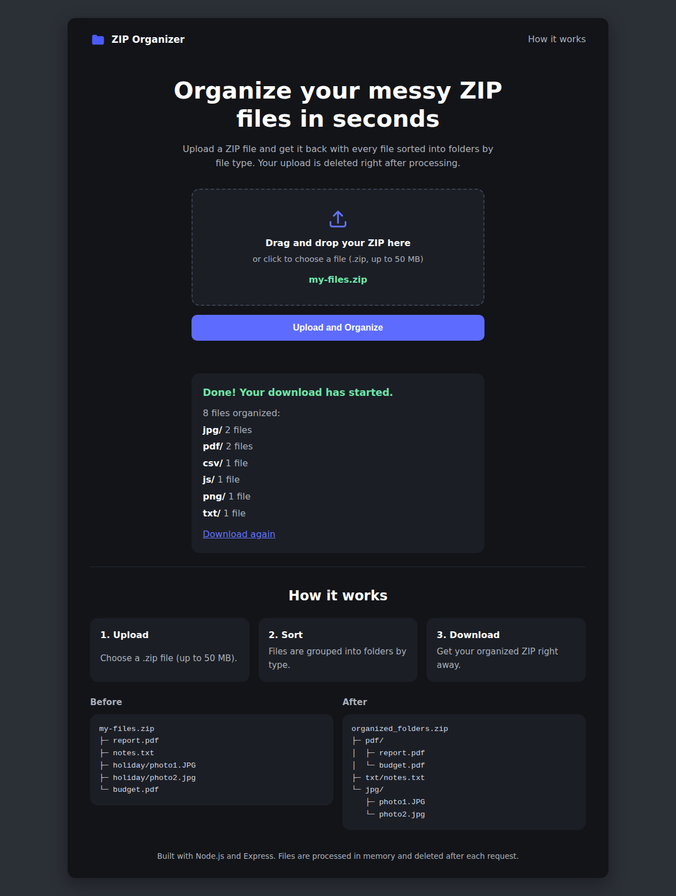

# ZIP File Organizer

[](https://github.com/<your-username>/zip-file-organizer/actions/workflows/ci.yml)


A Node.js and Express web app that cleans up messy ZIP files. Upload a ZIP, and the server sorts every file into folders by file type (`pdf/`, `jpg/`, `txt/`, ...) and returns a neatly organized ZIP for download.



## Features

- Drag-and-drop or click-to-upload page, no account needed
- Files grouped into folders by extension (case-insensitive); files without one go to `no_extension/`
- Summary of what was sorted after each upload
- Duplicate names are kept safely (`photo.jpg`, `photo (1).jpg`)
- Hidden files and macOS metadata (`__MACOSX`) are skipped
- Clear error messages for wrong file types, corrupt ZIPs, and empty ZIPs
- Uploaded and generated files are deleted right after each request

## Built-in Safety

- 50 MB upload limit, `.zip` files only
- Limits on file count (5,000) and total unzipped size (500 MB)
- Unsafe paths like `../` are ignored
- Rate limiting (50 uploads per 15 minutes per IP) and secure HTTP headers via Helmet
- A separate temporary file for every request, so users never overwrite each other

## Tech Stack

Node.js, Express, Multer (uploads), AdmZip (ZIP processing), Helmet, express-rate-limit, vanilla JavaScript front-end, Node's built-in test runner

## Run Locally

```sh
git clone https://github.com/<your-username>/zip-file-organizer.git
cd zip-file-organizer
npm install
npm start
```

Open http://localhost:3000, choose a ZIP file, and click **Upload and Organize**.

Use `npm run dev` to restart automatically when you change code, and set `PORT` to use a different port.

## Run the Tests

```sh
npm test
```

13 tests cover the sorting logic (extensions, duplicates, hidden files, limits, corrupt ZIPs) and the HTTP API (valid upload, wrong file type, no file, cleanup of temporary files).

## API

`POST /upload` with `multipart/form-data` and the field `zipfile`.
Returns `organized_folders.zip` on success, with an `X-Summary` header (JSON with file counts per folder). Returns `400` with a message on error.

```sh
curl -F zipfile=@my-files.zip http://localhost:3000/upload -o organized_folders.zip
```

`GET /health` returns `{"status":"ok"}`.

## Project Structure

```
index.js            Starts the server
src/app.js          Express app: upload route, limits, cleanup
src/organizer.js    ZIP sorting logic
public/             Front-end (HTML, CSS, JavaScript)
test/               Unit and API tests
.github/workflows/  CI that runs the tests on every push
```

## Deploy

Works on any Node.js host (for example Render or Railway). Use `npm install` as the build command and `npm start` as the start command. Set `NODE_ENV=production` when running behind a proxy.

## Ideas for Next Steps

- Sort by category (Images, Documents, Audio) instead of raw extension
- Support `.rar` and `.7z` archives
- Show a live progress bar for large uploads

## License

[MIT](LICENSE)

## Author

Hussain Mansoor, Software Engineering student, Karachi
